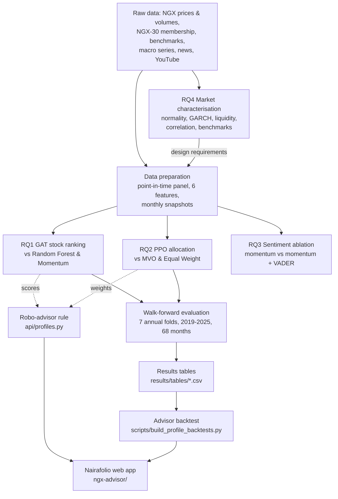
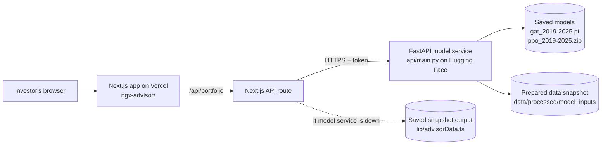

# My PhD Research, Explained: Progress Report Companion

**Machine Learning-Enhanced Portfolio Optimisation for Emerging Markets: A Two-Stage Approach for the Nigerian Stock Exchange**

Nnamdi Augustus Isichei · PHD24DST0004 · Centre for Cyberspace Studies, Nasarawa State University Keffi · Supervisor: Prof. H. K. Oduwole

*Prepared October 2026 from the repository's code, results tables and the Nairafolio app. Every number in this document comes from a file in `results/`, `data/processed/` or the published IndabaX paper; the source is named wherever it matters.*

---

## How to use this document

| If you want to… | Read |
|---|---|
| Explain the whole project in two minutes | [1. The research on one page](#1-the-research-on-one-page) |
| Understand the jargon | [2. Key terms in plain language](#2-key-terms-in-plain-language) |
| Explain how everything fits together | [3. Data](#3-the-data) and [4. Architecture and workflow](#4-architecture-and-workflow) |
| Present each research question | [5. The four research questions](#5-the-four-research-questions) |
| Answer "which model is best?" | [6. Every model used](#6-every-model-used-and-why) and [7. Which model performs best](#7-which-model-performs-best) |
| Plan the next phase and the novelty claim | [8. How to improve the method](#8-how-to-improve-the-method-and-make-it-novel) |
| Explain what changed since the proposal | [9. What changed since the proposal](#9-what-changed-between-the-proposal-and-now) |
| Demo the app | [10. The Nairafolio app](#10-the-nairafolio-app) |
| Talk through each figure | [11. Figure-by-figure guide](#11-figure-by-figure-guide) |
| Avoid being caught out | [12. Accuracy notes](#12-accuracy-notes-to-fix-or-be-ready-to-explain) and [13. Likely panel questions](#13-likely-panel-questions-and-suggested-answers) |

---

## 1. The research on one page

**The problem.** Most portfolio-building methods (for example Markowitz mean-variance optimisation) were designed for large, liquid, well-behaved markets like the US. The Nigerian Exchange (NGX) is different: returns have fat tails, volatility comes in long waves, trading is thin and lumpy, and the economy is exposed to oil and the naira. Methods built elsewhere may not work here, and almost no machine-learning portfolio research has been done on the NGX.

**The idea.** A two-stage machine-learning system:

1. **Stage 1, stock selection:** a **Graph Attention Network (GAT)** looks at how NGX stocks move together (a "graph" of stocks linked by correlation) and ranks which stocks are likely to do best next month.
2. **Stage 2, allocation:** a **reinforcement-learning agent (PPO)** decides how much money to put in each stock, learning by trial and error to earn returns after trading costs.

Around these sit two supporting studies: a characterisation of the NGX (RQ4, published) and a test of whether news sentiment helps (RQ3).

**Where things stand (October 2026).**

| Research question | Status | One-line result |
|---|---|---|
| **RQ4** What makes the NGX different? | Complete, **published** (PMLR Vol. 319, IndabaX Nigeria 2026) | Returns are non-normal, volatility clusters, liquidity is episodic, correlations are sparse except banks. |
| **RQ1** Does a GAT pick stocks better than simple methods? | **Prototype** (single seed) | GAT gives the widest top-vs-bottom return spread (2.22%/month); Random Forest has slightly better rank correlation. No clear winner yet. |
| **RQ2** Does reinforcement learning allocate better than mean-variance? | **Prototype** (single seed) | PPO's Sharpe (1.077) edges MVO (1.024) with far less trading, but PPO behaves almost exactly like equal weighting. |
| **RQ3** Does news sentiment add value? | Complete (exploratory) | No. Adding sentiment lowered returns slightly; the difference is not statistically significant (t = −0.82, p ≈ 0.41). |

**The app.** *Nairafolio* turns the research into a working robo-advisor: an investor answers five questions, sets an amount, duration and sector focus, and receives three NGX portfolios built from the GAT and PPO models, with estimates from the 2019–2025 test.

**The honest headline for the presentation:** the pipeline is built end to end, validated without look-ahead, and deployed as an app. The models already match or slightly beat the classic benchmarks on risk-adjusted return, but they do not yet clearly beat simple alternatives. The next phase (Section 8) is designed to close that gap and is where the main novelty will come from.

---

## 2. Key terms in plain language

| Term | Plain meaning | Rule of thumb |
|---|---|---|
| **Return** | How much an investment grew. A 10% monthly return turns ₦100 into ₦110. | Higher is better. |
| **CAGR** (compound annual growth rate) | The steady yearly growth rate that would produce the same end result. | "25.6% CAGR" ≈ money grew as if by 25.6% every year. |
| **Volatility** | How much returns bounce around (standard deviation, annualised). | Higher = bumpier ride. |
| **Sharpe ratio** | Return earned per unit of volatility (here with a zero risk-free rate). | Above 1 is good; compare like with like. |
| **Maximum drawdown** | The worst fall from a previous peak before recovering. | −40% means at the worst point you were 40% below your best value. |
| **Turnover** | How much of the portfolio is bought or sold each month (here: sum of absolute weight changes). | Higher turnover = more trading costs. |
| **Basis point (bp)** | One hundredth of one percent. 10 bps = 0.10%. | Used for trading costs. |
| **Information coefficient (IC)** | How well a model's ranking of stocks matches the actual ranking of next-month returns (Spearman rank correlation, −1 to +1). | 0.05 is often treated as practically useful in finance. |
| **Quintile spread** | Return of the model's top 20% of stocks minus its bottom 20%. | Positive = the model separates winners from losers. |
| **Walk-forward validation** | Train on the past, test on the next year, move forward, repeat. The model never sees the future. | The gold standard for honest backtests. |
| **Fold** | One train-then-test round. You have 7 folds (test years 2019 to 2025). | |
| **Point-in-time (PIT)** | Using only information that was actually available on that date, including which stocks were in the NGX-30 then. | Prevents hindsight bias. |
| **Survivorship bias** | Studying only today's surviving companies, which makes the past look better than it was. | Fixed by including former index members. |
| **Jarque-Bera (JB) test** | Tests whether returns follow a normal (bell-curve) distribution. | Large JB / tiny p-value = not normal. |
| **Skewness / kurtosis** | Skew: lopsidedness. Excess kurtosis: fatness of the tails (extreme days more common than a bell curve predicts). | Kurtosis above 0 = fat tails. |
| **GARCH persistence (α + β)** | How long volatility shocks last. Close to 1 = calm returns slowly after a shock. | Above 0.9 = very persistent. |
| **Coefficient of variation (CoV) of volume** | How erratic trading volume is (standard deviation ÷ mean). | High = trading comes in bursts. |
| **HAC t-statistic** | A t-test that corrects for returns being related over time (Newey-West). | |t| below about 2 = not statistically significant. |
| **p-value** | The chance of seeing a result this strong if there were really no effect. | Below 0.05 = usually called significant. |
| **Equal weight (EW)** | Put the same amount in every eligible stock. | A surprisingly hard benchmark to beat. |
| **MVO (minimum-variance)** | Markowitz-style optimiser that picks weights to minimise portfolio volatility. | The classic finance benchmark. |

---

## 3. The data

### 3.1 What you collected

| Data | Detail | Used for | Source in repo |
|---|---|---|---|
| **NGX stock prices and volumes** | 39 stocks, daily, Jan 2012 to Dec 2025 (3,653 trading days). Includes current NGX-30 members and former members (e.g. Cadbury, Conoil, GSK, Julius Berger, PZ, Unilever). | All RQs | `data/raw/ngx_stocks/`, `data/processed/` |
| **Point-in-time NGX-30 membership** | Which stocks were in the index when. 42 symbols listed; 3 (DIAMONB, MOBIL, UBN) had no usable prices, leaving 39. | RQ1, RQ2 | `data/processed/model_inputs/membership_used.csv` |
| **Global benchmarks** | S&P 500 and MSCI Emerging Markets. | RQ4 comparison | `data/raw/benchmarks/` |
| **Macroeconomic series** | Brent oil, NGN/USD, US dollar index, VIX, Fed funds, US 10-year yield, gold, Nigerian inflation, GDP growth, CBN policy rate (10 series). | RQ4 (Figure 4.3); **not used inside the models** | `scripts/ngx_research_data/raw/macro/` |
| **News headlines** | 1,954 headline records 2012–2025 (Google News ticker searches + GDELT), scored with VADER. | RQ3 | `results/tables/historical_headlines_vader_scored.csv` |
| **YouTube comments** | 77 comments from 20 videos (Sept–Oct 2026). Descriptive only, because they come after the price data ends. | RQ3 (descriptive) | `results/tables/youtube_*` |

### 3.2 How the data is prepared for the models (`scripts/prepare_model_data.py`)

1. **Daily returns** are computed from closing prices.
2. **Six features per stock** are computed each day, using only past data: 1-day return, 20-day and 60-day momentum, 20-day and 60-day volatility, and a 20-day volume z-score (how unusual today's volume is).
3. At the **end of each month**, a "snapshot" records each stock's features, whether it was in the NGX-30 that day, and its **next-month return** (the thing to predict).
4. The models never see a month's answer before predicting it.

### 3.3 Known data limitations (say these before someone else does)

- Prices are **not adjusted for dividends** or fully reconciled for corporate actions, so returns are price-only.
- Figures are in **nominal naira**. The naira fell from about ₦157 to about ₦1,518 per US dollar over the sample, so naira returns overstate dollar returns.
- News coverage is **sparse before 2021**; Google News results are capped search results, not a complete archive.

---

## 4. Architecture and workflow

### 4.1 The research pipeline



> **Important for your presentation:** in the evaluated experiments, **GAT and PPO were tested separately**. PPO's inputs are the six stock features, not the GAT's scores, so the PPO results in RQ2 are for PPO on the whole eligible universe. The two stages are only joined in the robo-advisor (Section 10). Joining them inside the model is the top improvement in Section 8.

### 4.2 The walk-forward protocol (why the results are honest)

For each test year *y* from 2019 to 2025:

| Model | Trains on | Tunes on | Tested on |
|---|---|---|---|
| GAT, Random Forest | months up to year *y*−2 | year *y*−1 (chooses when to stop training) | year *y* only |
| PPO | months up to year *y*−1 | – | year *y* only |
| MVO, Equal Weight | no training; use only past returns at each date | – | year *y* only |

The test months are then stitched together: 11 + 9 + 12 + 11 + 6 + 10 + 9 = **68 out-of-sample months**. Some months are missing because there were too few eligible stocks or missing labels. Each test year uses a model that has never seen that year.

### 4.3 The software architecture



---

## 5. The four research questions

### RQ4: What makes the NGX different? (Complete, published)

**Question.** What are the unique characteristics of the NGX (volatility, liquidity, structure) that require specialised portfolio methods?

**What you did.** Five standard tests, each translated into a design rule for the ML models:

| Property | Test | Finding (app, 39 stocks, 2012–2025) | Finding (paper, 22 stocks, 2015–2025) | Design rule it implies |
|---|---|---|---|---|
| Return shape | Jarque-Bera, skewness, kurtosis | All 39 reject normality; median excess kurtosis 4.66; 36 of 39 positively skewed | All 22 reject; median excess kurtosis 4.79; 19 of 22 positively skewed | Don't use bell-curve (variance-only) objectives; penalise drawdown/CVaR |
| Volatility | GARCH(1,1) | Median persistence 0.903; 20 of 39 above 0.90 | Median 0.912; 12 of 22 above 0.90 | Feed time-varying volatility to the models |
| Liquidity | Zero-volume days, volume CoV | 27 of 39 stocks have at least one no-trade day (CONOIL 111, JBERGER 93); median volume CoV 2.8 | Only 7 zero-volume days; mean CoV 1.85; risk is volume *episodicity* | Rebalance monthly at most; include costs |
| Correlation | Pearson matrix | Mean pairwise 0.072; banks are the only dense cluster (Financial mean 0.25; ACCESSCORP–UBA 0.56) | Mean 0.109; six-bank cluster dominates | Use attention to find the few real links |
| Benchmarks | Sharpe vs S&P 500, MSCI EM | NGX 1.57, S&P 0.80, MSCI EM 0.33 | NGX 1.40, S&P 0.71 | NGX rewards risk well in naira terms, but watch devaluation |

**Why the numbers differ between app and paper:** the paper used 22 stocks over 2015–2025; the current research panel was expanded to 39 point-in-time stocks over 2012–2025 (adding former index members). The qualitative findings are the same. **Quote the paper's numbers when citing the publication, and the app's numbers when presenting the expanded panel.**

### RQ1: Can a Graph Attention Network pick stocks better? (Prototype)

**Question.** Do GNNs with attention improve stock pre-selection compared with traditional methods on the NGX?

**What you did, simply.** Each month, every model scores every eligible stock. You then check:
- **IC:** did the ranking match what actually happened next month?
- **Quintile spread:** did the model's top fifth beat its bottom fifth?

**How the GAT works.**
- Each stock is a node.
- Two stocks are linked if their last 60 days of returns are correlated (|ρ| ≥ 0.30, at most 5 links per stock).
- Two attention layers let each stock "listen" to its most relevant neighbours. For example, a bank's score is informed by other banks.
- The output is a predicted rank for next month's return.
- It is trained by mean-squared error on the return rank, and stops training when validation-year error stops improving.

**Results (mean of 7 folds, `results/tables/gat_walkforward_metrics.csv`):**

| Model | Mean IC | Median spread | Mean spread | Folds with positive IC | Folds with positive spread |
|---|---:|---:|---:|---:|---:|
| **GAT (proposed)** | 0.054 | **1.54%** | **2.22%** | 6 of 7 | 5 of 7 |
| Random Forest | **0.061** | 0.43% | 0.82% | **7 of 7** | 4 of 7 |
| Momentum (60-day) | −0.023 | −0.42% | 0.93% | 3 of 7 | 3 of 7 |

**Interpretation.**
- The GAT is **best at separating winners from losers** (the spread). That is what matters most for building a portfolio from its top picks.
- Random Forest is **slightly better and more consistent at ranking the whole list** (IC).
- Simple momentum **fails** on the NGX: its IC is negative.
- GAT's average spread is lifted by one strong year (2022: +8.2%), so its median (1.54%) is a fairer summary.
- With one random seed and no significance test, **neither ML model can yet be called superior**. Your methodology report says the same.

### RQ2: Can reinforcement learning allocate better than mean-variance? (Prototype)

**Question.** How does RL-based portfolio optimisation compare with traditional mean-variance optimisation in a volatile emerging market?

**What you did, simply.**
- A PPO agent sees each stock's six features, whether it is in the index, last month's weights, and a market summary.
- It outputs a score per stock, which becomes weights: long-only, adding up to 100%, at most 20% per stock.
- Its reward is next month's return minus a 10 bps trading cost on the amount traded.
- It trains on all past months, then is tested on the next year.
- It is compared with minimum-variance MVO (also capped at 20%) and equal weight.

**Results (pooled 68 months, 10 bps cost, `results/tables/ppo_walkforward_cost_sensitivity.csv`):**

| Strategy | CAGR | Volatility | Sharpe | Max drawdown | Monthly turnover |
|---|---:|---:|---:|---:|---:|
| **PPO** | 25.6% | 24.0% | **1.077** | −39.8% | 15.2% |
| MVO (min-variance) | **26.4%** | 26.3% | 1.024 | −40.5% | 39.8% |
| Equal weight | 25.4% | 24.0% | 1.072 | **−39.6%** | **13.4%** |

**The key finding you must understand.** PPO's monthly returns have a **correlation of 0.9999 with equal weight**, and differ by only 0.075 percentage points a month on average. PPO holds 28 to 33 stocks every month with nearly equal weights. In plain words: **the PPO agent has learned to equal-weight the portfolio.** That is not a failure: equal weight is a strong, well-known benchmark, and PPO found it on its own. But it means PPO is not yet adding a distinct allocation skill. The likely causes:
- a very small training budget (2,048 steps per fold);
- no access to GAT scores;
- a reward that only counts return.

**What does hold up.** PPO trades far less than MVO (15% vs 40% a month), so it loses less when costs rise (Figure 4.7). MVO earned slightly more in raw terms (26.4% vs 25.6% CAGR at 10 bps), but at 50 bps PPO overtakes it (24.7% vs 24.1%).

### RQ3: Does news sentiment add value? (Complete, exploratory)

**Question.** Does adding sentiment from financial news and social media improve portfolio performance beyond price-based features?

**What you did, simply.**
- **Two strategies were compared on the same months:**
  - *price-only momentum:* buy the top fifth of stocks by 60-day return;
  - *momentum + sentiment:* rank stocks on an equal blend of momentum and the average VADER score of their headlines over the previous 30 days.
- **Headlines** are assigned to the next trading day to avoid look-ahead.
- **Significance** of the monthly difference was tested with a Newey-West (HAC) t-test.

**Results (2021–2025, 60 months; `results/tables/sentiment_increment_metrics_2021_2025.csv`):**

| Strategy | CAGR | Sharpe | Max drawdown | Monthly turnover |
|---|---:|---:|---:|---:|
| Price-only momentum | **54.0%** | 1.460 | −24.5% | 43.1% |
| Momentum + sentiment | 49.0% | 1.369 | −24.0% | 49.3% |
| Equal weight | 37.2% | **1.639** | **−19.1%** | 1.9% |

Sentiment minus price-only: −3.45 percentage points a year, 95% interval −11.7% to +4.8%, t = −0.82, p ≈ 0.41.

**Interpretation.** Adding headline sentiment did **not** help, and it slightly raised trading. The interval includes zero, so this shows **no evidence of benefit**, not proof that sentiment can never help. Coverage was thin: in 2021–2025 only about 2 of the ~8 stocks selected each month had recent ticker-specific news (under 1 per month over the full 2012–2025 sample). The full 2012–2025 run gives the same answer (t = −0.415). This is still a valuable, publishable negative result: it is the first such test for an African frontier market.

Note that this test used **momentum**, not the GAT, and is **gross of trading costs** (costs are a separate sensitivity table).

---

## 6. Every model used, and why

| Model | Type | Role | Why it was chosen | Where |
|---|---|---|---|---|
| **Graph Attention Network (GAT)** | Graph neural network | RQ1 stock ranking (proposed) | Stocks influence each other; attention can learn *which* links matter, which suits the NGX's sparse correlation structure (RQ4) | `scripts/train_gat_walkforward.py` |
| **Random Forest** | Tree ensemble (150 trees) | RQ1 ML baseline | Strong, standard non-graph ML benchmark; tests whether the graph adds anything | same script |
| **Momentum (60-day)** | Rule | RQ1 traditional baseline; RQ3 base strategy | The classic "technical analysis" stock picker | same script; `scripts/analyze_sentiment_increment.py` |
| **PPO (Proximal Policy Optimisation)** | Reinforcement learning (actor-critic, Stable-Baselines3, 2×32 network) | RQ2 allocation (proposed) | Handles continuous weights, learns from rewards that include costs, stable to train | `scripts/train_ppo_walkforward.py` |
| **Minimum-variance MVO** | Classical optimiser | RQ2 traditional baseline | The textbook Markowitz-family benchmark the RQ asks about | same script |
| **Equal weight** | Rule | RQ2/RQ3 naive benchmark | Hard to beat in practice; checks whether optimisation helps at all | same script |
| **VADER** | Lexicon sentiment scorer | RQ3 text scoring | Fast, transparent, needs no training data | `scripts/analyze_historical_sentiment_coverage.py` |
| **GARCH(1,1)** | Volatility model | RQ4 analysis | Standard way to measure volatility clustering | `notebooks/ngx_market_analysis.ipynb` |
| **Jarque-Bera, Pearson correlation, HAC t-test** | Statistical tests | RQ4, RQ3 | Standard evidence for normality, structure and significance | notebooks, scripts |
| **Advisor profile rule** | Rule on top of GAT + PPO | The app | Turns model outputs into 3 risk-graded portfolios | `api/profiles.py` |

---

## 7. Which model performs best?

| Contest | Winner | Runner-up | Verdict |
|---|---|---|---|
| Stock ranking accuracy (IC) | Random Forest (0.061) | GAT (0.054) | Close; RF is more consistent |
| Picking winners vs losers (spread) | **GAT (2.22% mean, 1.54% median)** | Momentum (0.93% mean) | GAT best on the metric closest to portfolio profit |
| Risk-adjusted allocation (Sharpe) | **PPO (1.077)** | Equal weight (1.072) | Practically a tie; PPO ≈ equal weight |
| Raw return (CAGR at 10 bps) | MVO (26.4%) | PPO (25.6%) | MVO, but with 2.6× the trading |
| Cost robustness | **PPO** | Equal weight | PPO loses 0.029 Sharpe from 5→50 bps; MVO loses 0.078 |
| Sentiment value | Price-only momentum | Momentum + sentiment | Sentiment does not help (not significant) |
| Advisor profiles (in-sample) | Conservative (Sharpe 1.12, drawdown −30%) | Moderate (1.10) | Concentrating on top GAT picks with a liquidity filter beat full PPO, but the rule was chosen on the same data |

**Overall:** your proposed models are **competitive but not yet clearly superior**. The GAT shows the most promise (best spread). PPO currently reproduces equal weighting. That is a normal and defensible position for a progress report. Section 8 sets out how to turn it into a clear contribution.

---

## 8. How to improve the method and make it novel

### 8.1 Gap check against your own published design requirements

Your IndabaX paper (Section "Implications for ML Portfolio Design") set five requirements. Here is how the current prototype measures up:

| Requirement from the paper | Status in current code | What to do |
|---|---|---|
| Downside-sensitive reward (penalise drawdown and CVaR, not just variance) | **Not done.** Reward is return minus cost | Add drawdown/CVaR penalty to PPO reward |
| Adaptive volatility features, including GARCH conditional variance | **Partly.** 20/60-day realised volatility only | Add GARCH-implied variance and volatility-regime features to both models |
| Monthly or weekly rebalancing with NGX-calibrated costs | **Partly.** Monthly ✓, but 10 bps is an assumption | Calibrate costs to actual NGX fees plus a liquidity-based market-impact term |
| GNN attention over raw correlation; validate attention on the bank cluster | **Partly.** GAT ✓, attention never inspected | Extract attention weights and show they recover the banking cluster |
| Hard exclusion filters for structural outliers (TRANSCO, UCAP) | **Not done.** TRANSCORP is still in the universe | Add persistence/kurtosis screens before training |

### 8.2 Prioritised improvements

**Priority 1: make the two stages truly two-stage (biggest novelty lever).**
- Feed the GAT's scores (or GAT embeddings) into PPO's state, and/or let PPO choose only among the GAT's top-ranked stocks.
- Today they are separate experiments. A joint "GAT-informed PPO", compared against stand-alone PPO and stand-alone GAT, is the real test of your primary research question.

**Priority 2: fix the PPO learning problem.**
- **Budget:** raise training from 2,048 to at least 50,000–200,000 steps per fold, and check learning curves.
- **Reward:** use a downside-aware reward (return − λ·drawdown − μ·CVaR − cost), as your paper requires.
- **Seeds:** run 5–10 seeds per fold and report mean ± confidence interval.
- **Why this matters:** if PPO still converges to equal weight, that itself is a finding ("on the NGX, learned allocation collapses to 1/N"). Either way you get a defensible answer.

**Priority 3: an NGX-specific graph (novel and natural for the GAT).**
- **Multi-relational edges:** correlation + same sector + supply-chain/ownership links (e.g. Dangote group, banking peers).
- **Liquidity-aware nodes:** add volume CoV and zero-volume rate as node features, so the model learns to discount illiquid stocks (your RQ4 finding, now inside the model).
- **Macro context node:** Brent oil and NGN/USD as a global node every stock can attend to (oil and FX shocks drive the NGX, Figure 4.3).
- **Ranking loss:** train with a listwise/pairwise ranking loss instead of MSE, since you care about order, not exact values.

**Priority 4: combine strengths.**
- RF is consistent on IC; GAT is better at the extremes. A **GAT + RF stack** (or GAT with RF features) is a cheap experiment that may beat both.

**Priority 5: make the evidence statistically solid.**
- **Significance tests:**
  - Diebold-Mariano or bootstrap tests for IC and spread differences;
  - the Ledoit-Wolf test for Sharpe-ratio differences;
  - a superior predictive ability (SPA) / reality check, because several strategies were compared.
- **Proposal metrics:** report the ones promised but not yet produced: Sortino, Calmar, CVaR, and alpha vs the NGX All-Share Index.

**Priority 6: data credibility.**
- Use **dividend-adjusted total returns** and reconcile corporate actions.
- Report results in **both naira and US dollars**, or in real terms (inflation-adjusted), given the devaluation.

**Priority 7: sentiment, done better (RQ3 extension).**
- Use a finance-specific model (FinBERT, or a model fine-tuned on Nigerian financial English) instead of VADER.
- Build a timestamped, ticker-attributed archive.
- Test sentiment as a **GAT node feature** rather than a momentum blend.

### 8.3 A one-sentence novelty statement to aim for

> *"The first NGX-specific two-stage framework in which a liquidity- and macro-aware multi-relational graph attention network informs a downside-risk-rewarded reinforcement-learning allocator, validated walk-forward on a survivorship-free point-in-time panel with NGX-calibrated costs."*

Every clause in that sentence is tied to one of your RQ4 findings. That is the strongest possible justification for novelty: the design is derived from evidence about this market, not borrowed from US studies.

---

## 9. What changed between the proposal and now

| Area | Proposal / original plan | Now | Why it changed |
|---|---|---|---|
| Sample | 2015–2025, top 30–50 stocks | 2012–2025, 39 point-in-time NGX-30 stocks (incl. former members) | Longer history; avoid survivorship bias |
| RQ4 sample | – | Paper: 22 stocks 2015–2025; app: 39 stocks 2012–2025 | Panel expanded after the paper was written |
| RQ1 baselines | LSTM, Random Forest, XGBoost, technical analysis | Random Forest and 60-day momentum | Prototype scope; LSTM/XGBoost still to add |
| RQ2 algorithms | DQN and PPO; multi-objective agents for return, risk, drawdown | PPO only; single reward (return − cost) | PPO suits continuous weights; DQN needs discrete actions; multi-objective deferred |
| RQ2 reward | Returns, Sharpe, max drawdown | Net return after 10 bps cost | Prototype simplification; downside reward is the next step |
| RQ2 baselines | MVO, equal weight, buy-and-hold | Minimum-variance MVO, equal weight | Buy-and-hold not yet added |
| Two-stage link | GNN pre-selects, RL allocates | Evaluated separately; joined only in the app | Built and validated each stage first |
| Macro data | Inputs to the models | Collected; used in RQ4 only | Kept models price-based for the prototype |
| Sentiment (RQ3) | News + social media, "conditional" | Google News + GDELT headlines (VADER); YouTube descriptive only | Social data post-dates prices; historical GDELT API unavailable |
| Explainability | SHAP, LIME, attention visualisation | Not yet done | Deferred to the full model phase |
| Cross-market validation | JSE, NSE | Not done (S&P 500, MSCI EM used only as RQ4 benchmarks) | Scope; candidate for future work |
| Costs | Nigerian market rates | 10 bps assumption, with 5–50 bps sensitivity | NGX rates not yet calibrated |
| Evaluation metrics | Sharpe, Sortino, Calmar, IR, VaR, CVaR, alpha vs ASI | Sharpe, CAGR, volatility, max drawdown, turnover, IC, spread | Prototype metrics first |
| Backtest window | 2022–2024 | Walk-forward 2019–2025, 7 folds, 68 months | Stronger, longer out-of-sample test |
| Publication | IndabaX "submitted" | Published, PMLR Vol. 319 | Accepted |
| **Advisor flow (original plan)** | 22 equities; portfolios of 4/6/8 stocks; rebalance every 60 days; estimated return 18–27%; max drawdown ≤ 15% | 39-stock universe; portfolios of 10/8/5 stocks; monthly rebalancing; estimates measured from the models' 2019–2025 test | Your data showed fewer stocks = more risk; monthly matches training; no tested strategy achieved ≤15% drawdown (full PPO: −39.8%) |
| Headline figures in app | PPO CAGR 29.12%, max drawdown −20.64% | 25.6%, −39.8% (from results tables) | Aligned with `results/tables` |

---

## 10. The Nairafolio app

### 10.1 What it is

A web app that presents the research (Overview, Research) and lets a user try the robo-advisor (Advisor). It is built with Next.js (front end, hosted on Vercel) and a FastAPI model service (hosted on Hugging Face) that loads the saved GAT and PPO models.

| Page | Purpose in your presentation |
|---|---|
| **Overview** | The elevator pitch: headline numbers, the four RQs, the framework, the publication |
| **Research** | All figures from Chapter 4, rebuilt as interactive charts (hover for values, table icon for the data) |
| **Advisor** | Live demo of the research applied to a real investor |

### 10.2 How the advisor works, step by step

1. **Investor profile.** Five questions (goal, reaction to a 30% fall, experience, share of savings, need for cash within a year). Each answer scores 1–3. Total 5–8 → Conservative, 9–12 → Moderate, 13–15 → Aggressive.
2. **Parameters.**
   - **Amount:** ₦50,000 to ₦10,000,000. Pick a preset or type any amount. The ceiling reflects RQ4: large orders move thinly traded stocks.
   - **Duration:** any number of months or years, from 1 month to 10 years. One month is the shortest because the model rebalances monthly. **The suggested minimum is 1 year**, one walk-forward fold, which is how all results are measured. A shorter duration shows how often that profile gained over that length historically, and steps the suggestion one level more cautious.
   - **Sector focus:** All, Financial, Oil & Gas, Consumer or ICT. Small sectors (ICT has 2 stocks, Oil & Gas 5) fill remaining slots from other sectors, and each stock says so.
3. **Analysis.** The app calls the model service, which runs the latest saved GAT and PPO (2025 fold) on the latest prepared data snapshot.
4. **Results.** Three portfolios, with the suggested one highlighted.

### 10.3 How the three portfolios are built (`api/profiles.py`)

1. **Liquidity filter (from RQ4):** drop stocks with any no-trade day in the last 60 sessions, or median volume in the bottom quarter.
2. **Risk screen:** Conservative also drops the most volatile 30% of what remains.
3. **Stage 1 (GAT):** take the top-ranked stocks by GAT score, preferring the chosen sector.
4. **Stage 2 (PPO):** weight them using PPO's weights, re-scaled to 100%, capped at 20% each.
5. **Risk is set by concentration:** Conservative 10 stocks, Moderate 8, Aggressive 5. Rebalance monthly.

**Historical estimates** come from replaying the saved models over all 68 test months with this exact rule (`scripts/build_profile_backtests.py`). The replay reproduces your recorded PPO returns exactly before any estimate is produced.

| Profile (All sectors) | Stocks | CAGR | Volatility | Sharpe | Worst fall | Typical 12-month range (middle 50%) |
|---|---:|---:|---:|---:|---:|---|
| Conservative | 10 | 28.9% | 25.7% | 1.12 | −30.2% | +10.6% to +70.4% |
| Moderate | 8 | 34.7% | 31.4% | 1.10 | −37.5% | +7.4% to +86.7% |
| Aggressive | 5 | 35.4% | 43.5% | 0.89 | −38.2% | +9.5% to +95.7% |
| *Full PPO (reference)* | *~30* | *25.6%* | *24.0%* | *1.08* | *−39.8%* | *+10.6% to +69.4%* |

**Caveats shown in the app (say them in the demo):**
- The profile sizes and screen were chosen by comparing a few rules on the same 2019–2025 months, so the estimates are **likely optimistic**.
- Costs are 10 bps, but real NGX fees are higher, and the profiles trade much more than full PPO.
- The data snapshot is dated **28 Nov 2025**, so recommendations are historical until the data is refreshed.
- Prices are indicative.
- The disclaimer reads: *"This is not financial advice. Estimates are based on historical model performance and carry uncertainty."*

**Fallback.** If the model service is asleep or down, the app shows the saved model output for the same snapshot, labelled "Saved model output", instead of failing.

### 10.4 Suggested 3-minute live demo script

1. **Overview** (30 s): "Two-stage GAT + PPO, 39 stocks, 14 years, 7 walk-forward folds; RQ4 is published."
2. **Research → Figure 4.2** (30 s): hover the bank block. "The only dense cluster is the banks. This is why we use attention rather than raw correlation."
3. **Research → Figure 4.6a** (30 s): "PPO and equal weight move together, which is our key RQ2 finding and the focus of the next phase."
4. **Advisor** (90 s):
   - Answer the questions as a cautious investor.
   - Enter **₦750,000** and **8 months**, and point out the short-duration warning.
   - Choose **Oil & Gas**.
   - Show the three portfolios, the "filled from other sector" tags, the historical range for 8 months, and the disclaimer.

---

## 11. Figure-by-figure guide

Each entry gives: **what it shows → how to read it → key numbers → what it means for the research → what it means for an NGX investor using the advisor.**

### Overview page tiles

| Tile | Meaning | Source |
|---|---|---|
| **1.077 Pooled Sharpe ratio** | PPO's return per unit of risk over the 68 test months | PPO, 10 bps |
| **2.22% GAT quintile spread** | GAT's top fifth beat its bottom fifth by 2.22% per month on average | 7-fold mean |
| **15.2% PPO monthly turnover** (vs MVO 39.8%) | PPO trades about 2.6× less than MVO | |
| **25.6% Annual CAGR** | PPO's compound growth rate, net of 10 bps cost | |
| **39 NGX equities** | Point-in-time panel, 2012–2025 | |
| **7 walk-forward folds** | 2019–2025 test years, 68 usable months | |

*Investor implication:* the models' tested record is about 25% a year in naira with 1-in-1 return-to-risk. That is good in naira terms but comes with deep falls (about −40% at worst).

---

### Figure 4.1a: Pooled daily returns vs a normal fit

- **Shows:** the distribution of all daily stock returns (113,358 stock-days) with a bell curve of the same mean and volatility overlaid.
- **Read it:** where the blue bars sit above the green curve, real life produces that move more often than the bell curve predicts.
- **Key numbers:**
  - **Spike at 0%:** a huge number of zero-return days. These are days a stock didn't trade or didn't move, a liquidity signature.
  - **Fat tails:** excess kurtosis 3.55 on the pooled data (skew 0.047).
- **Research meaning:** variance-based optimisers assume the bell curve and will underestimate extreme days. This justifies downside-risk rewards and ML methods (RQ4 → RQ2).
- **Investor meaning:** big single-day moves and days with no trading are both normal on the NGX. Expect jumps, and don't panic on one bad day.

### Figure 4.1b: Jarque-Bera normality test by stock

- **Shows:** each stock's JB statistic (in thousands). Every bar is far above the 1% critical value (9.2, i.e. 0.009 thousand).
- **Read it:** longer bar = further from a bell curve.
- **Key numbers:**
  - All 39 stocks reject normality.
  - ETI (~182k) and AIRTELAFRI (~34k) lead among the plotted stocks.
  - TRANSCORP (≈174.6M) and WEMABANK (≈109.8M) are such extreme outliers they are left out of the plot; see the table view.
- **Research meaning:** non-normality is universal, not a few odd stocks. TRANSCORP's extremity is exactly why your paper calls for hard exclusion filters (not yet implemented; Section 8).
- **Investor meaning:** some stocks (e.g. TRANSCORP) have histories of extreme moves. Single-stock risk is real, which is why the advisor diversifies and caps each stock at 20%.

### Figure 4.1c: NGX vs global benchmarks (Sharpe)

- **Shows:** annualised Sharpe ratio, 2012–2025: NGX 1.57, S&P 500 0.80, MSCI EM 0.33.
- **Read it:** taller = more return per unit of risk. NGX is highlighted.
- **Key numbers:** NGX return 25.5%/yr at 16.3% volatility; S&P 500 13.5% at 16.8%; MSCI EM 6.6% at 19.9%.
- **Research meaning:** the NGX rewards risk well in local-currency terms, so it is worth optimising.
- **Investor meaning (critical caveat):** these are **naira** figures. The naira lost about 90% of its dollar value (₦157 → ₦1,518 per USD), roughly 17.6% a year. In US-dollar terms, the NGX's return over this period was only in the single digits. Naira-based investors gain; dollar-based investors should be cautious.

### Figure 4.2: Return correlation matrix with sector blocks

- **Shows:** a 39×39 grid of pairwise correlations. Red = move together, blue = move opposite, grey = unrelated. Outlined squares are sectors.
- **Read it:** hover any cell. Dark red clusters show groups that rise and fall together.
- **Key numbers:**
  - Mean pairwise correlation is only 0.072, and 326 of 741 pairs are below 0.05.
  - The Financial block is the only dense area (sector mean 0.25; ACCESSCORP–UBA 0.56, GTCO–ZENITHBANK 0.54).
- **Research meaning:** a sparse matrix with one bank cluster means a model that uses *every* correlation would be mostly noise. Attention lets the GAT focus on the few links that matter (RQ4 → RQ1). The bank cluster is the natural test of whether the GAT's attention learned something real.
- **Investor meaning:**
  - Holding several banks is **not** diversification, because they move together.
  - Mixing sectors (banks + consumer + oil + industrials) genuinely spreads risk. The advisor's sector mix does this.

### Figure 4.3: NGX volatility against macroeconomic regimes (three linked panels)

- **Shows:**
  - (a) average 60-day volatility of the five most liquid stocks;
  - (b) Brent crude oil price;
  - (c) the official NGN/USD rate.
  - Shaded spans mark stress regimes; hover any panel to read all three for that week.
- **Key numbers:**
  - Volatility spikes to about 70–80% in 2015–16, around COVID-19 in 2020, and during 2022–24.
  - Oil fell below $20 in April 2020 and peaked above $120 in 2022.
  - The naira moved from ~₦157 (2012) to ~₦1,518 (2025), with the sharpest step in 2023–24.
- **Research meaning:** NGX risk is driven by regimes (oil and currency shocks), and volatility persists after shocks (GARCH ~0.90). This supports adding volatility and macro features to the models (Section 8).
- **Investor meaning:**
  - Expect calm periods to be interrupted by oil or currency shocks, and expect turbulence to last months.
  - Use money you won't need soon; this is why the advisor suggests at least 1 year.

### Figure 4.4a: Volume coefficient of variation by stock

- **Shows:** how erratic each stock's trading volume is. Red = above the 75th-percentile threshold (CoV > 4.16).
- **Key numbers:** 10 of 39 stocks (26%) are above the threshold. WEMABANK, BUAFOODS and DANGCEM are the most episodic. The large caps GTCO and ZENITHBANK are among the steadiest.
- **Research meaning:** NGX liquidity risk is about *bursts* of trading rather than constant illiquidity. Rebalancing should be monthly at most, with costs (RQ4 → RQ2 design).
- **Investor meaning:** you may not be able to buy or sell some stocks quickly at a fair price. The advisor's liquidity filter removes the worst offenders, and the ₦10M ceiling limits market impact.

### Figure 4.4b: Zero-volume trading days per stock (top 20)

- **Shows:** days with no trading at all.
- **Key numbers:** CONOIL 111, JBERGER 93, INTBREW 64; 27 stocks have at least one such day (499 in total). Most of these are former or smaller index members. The paper's 22-stock sample had only 7.
- **Research meaning:** including former index members (survivorship-bias control) brings in genuinely illiquid names. The models must handle them; the advisor filters them out.
- **Investor meaning:** stocks with many no-trade days can trap your money. Prefer liquid names, which the advisor enforces.

### Figure 4.5a: Mean monthly information coefficient (RQ1)

- **Shows:** average IC for GAT (+0.054), Random Forest (+0.061) and Momentum (−0.023), with the 0.05 practical threshold.
- **Research meaning:** both ML models clear the threshold; momentum does not. Machine learning extracts ranking signal where simple technical analysis fails on the NGX.
- **Investor meaning:** "buy what went up recently" does not reliably work on the NGX; model-based ranking does somewhat better.

### Figure 4.5b: Mean top-minus-bottom quintile spread (RQ1)

- **Shows:** the GAT's top-fifth picks beat its bottom fifth by **2.22% a month** on average, vs 0.82% (RF) and 0.93% (Momentum).
- **Research meaning:** the GAT is best at the extremes, which is what a stock-picking stage needs. This is your strongest RQ1 evidence. Present the median (1.54%) alongside it, as 2022 lifts the mean.
- **Investor meaning:** the GAT's top-ranked stocks have historically done better than its bottom-ranked ones. That is why the advisor builds portfolios from GAT top picks.

### Figure 4.5c: Information coefficient by walk-forward fold

- **Shows:** IC per test year for each model.
- **Key numbers:**
  - GAT is positive in 6 of 7 years (negative in 2021) and RF in 7 of 7.
  - GAT beats RF on IC in only 2 years (2019, 2023), but beats it on spread in 5.
  - 2022 was strong for both ML models.
- **Research meaning:** results vary a lot by year, so more seeds and significance tests are needed before claiming superiority.
- **Investor meaning:** model edge is real on average but not every year. Judge any strategy over several years, not one.

### Figure 4.6a: Growth of ₦1, net of 10 bps (RQ2)

- **Shows:** cumulative wealth of PPO, MVO and equal weight over the 68 stitched test months.
- **Key numbers:**
  - ₦1 became about ₦3.64 (PPO), ₦3.77 (MVO) and ₦3.61 (equal weight).
  - All three fell in 2019–2020 and surged in 2023–2025.
  - The PPO and equal-weight lines are almost identical (correlation 0.9999).
- **Research meaning:** this is the key RQ2 picture. PPO currently reproduces equal weighting; the next phase must give it reasons to deviate (GAT input, downside reward, more training).
- **Investor meaning:**
  - Even a well-built strategy fell for about two years before recovering. Patience matters.
  - Much of 2023–25's growth coincided with naira devaluation and inflation, so part of it is nominal.

### Figure 4.6b: Annual Sharpe ratio by test year

- **Shows:** each strategy's Sharpe in each test year.
- **Key numbers:**
  - All three were negative in 2019 and about zero in 2020.
  - PPO was strongest in 2023 (4.57) and 2024 (3.74).
  - MVO had the best Sharpe in 2020, 2021, 2022 and 2025.
- **Research meaning:** no allocator dominates every year. Market regime matters more than the method, which supports regime-aware features.
- **Investor meaning:** the same portfolio can have very good and very bad years. The advisor shows a *range* of 12-month outcomes for this reason.

### Figure 4.7: Transaction cost sensitivity

- **Shows:** Sharpe at 5, 10, 25 and 50 bps one-way cost.
- **Key numbers:** from 5 to 50 bps, PPO falls 1.080 → 1.051 (−0.029) while MVO falls 1.032 → 0.954 (−0.078). At 50 bps, PPO's CAGR (24.7%) overtakes MVO's (24.1%).
- **Research meaning:** low-turnover learned allocation is more robust to NGX trading frictions. This is a genuine, defensible PPO advantage over MVO.
- **Investor meaning:** fees eat returns, especially for strategies that trade a lot. Real NGX costs are higher than 10 bps, so favour lower-turnover approaches and avoid over-trading.

### Figure 4.8a: Unique news articles per year

- **Shows:** ticker-specific headlines per year, shaded by coverage tier.
- **Key numbers:** from 1 article (2012) to 690 (2025). Coverage only becomes "adequate" (≥42% of trading days) from 2021.
- **Research meaning:** pre-2021 news is too sparse to test, which is why the ablation runs 2021–2025.
- **Investor meaning:** reliable, stock-specific Nigerian financial news is a recent development; older news-driven signals are unreliable.

### Figure 4.8b: Trading-day sentiment coverage

- **Shows:** the share of trading days with at least one scored headline, rising from 0.4% (2012) to 85% (2025), with the 42% "adequate" line.
- **Research meaning:** future sentiment work is now feasible; past work was data-limited.
- **Investor meaning:** news is increasingly available, but more news does not automatically mean better decisions (see 4.8c).

### Figure 4.8c: Portfolio ablation results, 2021–2025

- **Shows:** CAGR of price-only momentum (54.0%, Sharpe 1.460), momentum + sentiment (49.0%, 1.369) and equal weight (37.2%, 1.639).
- **Research meaning:** sentiment did not add value (HAC t = −0.82, p ≈ 0.41). Equal weight had the best risk-adjusted result. Note: these figures are before trading costs, and the momentum strategies trade about 43–49% a month.
- **Investor meaning:** trading on headlines did not help on the NGX in this period. A steady, diversified approach delivered the best return per unit of risk.

### Figure 4.9: Growth of ₦1, news sentiment increment

- **Shows:** cumulative wealth 2021–2025: price-only momentum ₦8.67, momentum + sentiment ₦7.35, equal weight ₦4.87.
- **Research meaning:** the gap between the two momentum lines opens mainly in 2024–25 and is not statistically reliable. The negative result is robust to the full 2012–2025 run.
- **Investor meaning:** the momentum strategies ended higher but with deeper falls and much more trading; the equal-weight line was smoother.

### Advisor results page

| Element | Meaning | Investor implication |
|---|---|---|
| **"Typical 12-month return"** (e.g. +10.6% to +70.4%) | The middle half of all historical 12-month periods for that profile | Expect results inside this range half the time, and outside it the other half |
| **"Annualised return"** | CAGR over the 68 test months | A long-run average, not a promise |
| **"Worst fall from peak"** | Maximum drawdown in the test | Be prepared to see your balance drop this much at some point |
| **"Over your duration…"** | Share of historical periods of your length that gained, and the middle-50% ending value of your amount | Short durations have wider, more uncertain outcomes |
| **Weights, ₦ amounts, ≈ shares** | How to split your money; share counts at indicative prices from 28 Nov 2025 | Check live prices before buying; you may need more money to own every stock |
| **"Filled from other sector"** | Not enough eligible stocks in your chosen sector | Sector-focused portfolios still diversify |
| **Growth chart** | How your amount would have grown under each profile, 2019–2025 | All profiles fell first, then grew; patience was rewarded in this period |
| **"Live / Saved model output" + signal date** | Whether the model ran now, and how old its data is | Recommendations are only as current as the data snapshot |

---

## 12. Accuracy notes: to fix or be ready to explain

| Item | Issue | Suggested action |
|---|---|---|
| ~~Research page tile "Intra-sector correlation 0.39 vs 0.16"~~ | Not reproducible from the data or the paper | **Fixed:** tile now reads "Banking-cluster correlation 0.25 vs 0.07 across all stock pairs", calculated from the correlation matrix; Figure 4.2 caption updated to match |
| ~~Research page tile "Illiquid stocks 27%"~~ | Data gives 10 of 39 = 25.6% | **Fixed:** tile now reads 26% (10 of 39), calculated from the liquidity results |
| App RQ4 numbers vs paper | App = 39 stocks 2012–2025; paper = 22 stocks 2015–2025 | Say which sample you are quoting |
| TRANSCORP in the universe | Paper says it must be excluded; it is still in the panel and can appear in advisor portfolios | Implement the exclusion filter (Section 8) |
| Methodology report | Says 5,000 PPO steps in one place and 2,048 in another (code: 2,048); duplicate "Current RQ2 Results" heading; describes turnover as half the sum of weight changes, while the code uses the full sum | Tidy `results/reports/gat_rl_walkforward_methodology.md` |
| Two-stage claim | GAT and PPO were evaluated separately | Describe as "both stages built and validated; integration is the next phase" |
| Costs | 10 bps is an assumption; real NGX dealing costs (brokerage, regulatory fees, stamp duty) are generally much higher | Present 4.7 as sensitivity; calibrate next |
| Data staleness | Snapshot 28 Nov 2025; prices end Dec 2025 | Refresh data before any public launch |
| Nominal returns | All returns in naira, not dividend-adjusted | Add USD and real-terms results |

---

## 13. Likely panel questions and suggested answers

**"Your PPO is the same as equal weight. What has RL contributed?"**
> "That is our main RQ2 finding so far. With a short training budget and a return-only reward, PPO converged to near-equal weights, which is itself a strong benchmark. Its distinct advantage is lower turnover and cost robustness versus MVO (Figure 4.7). The next phase adds GAT signals, a downside-risk reward and more training, so we can test whether PPO deviates profitably from 1/N."

**"Random Forest has a higher IC. Why use a GAT?"**
> "IC measures ranking across the whole list; spread measures whether the top picks beat the bottom picks, which drives portfolio returns. The GAT has the best spread (2.22% mean, 1.54% median vs 0.43% for RF). Neither is significant yet with one seed; multi-seed runs and significance tests are planned, and a GAT–RF stack is a cheap experiment to combine their strengths."

**"How do you know there's no look-ahead bias?"**
> "Walk-forward folds: each test year uses models trained only on earlier data, point-in-time index membership, features computed strictly before each signal date, and headlines shifted to the next trading day."

**"Are these returns real?"**
> "They are nominal naira, price-only and use an assumed 10 bps cost. The naira lost about 90% of its dollar value over the sample, so dollar returns are much lower. Total-return and USD/real-terms results are on the plan."

**"What is novel?"**
> "An NGX-specific design derived from our published characterisation: liquidity- and macro-aware graph attention for selection, a downside-risk-rewarded RL allocator, survivorship-free point-in-time data, and NGX-calibrated costs. Plus the first sentiment-increment test on an African frontier market, and a deployed advisor."

**"Why monthly rebalancing and not 60 days?"**
> "The models were trained and validated monthly, and RQ4 showed liquidity is episodic, so monthly is the most frequent interval the evidence supports. A 60-day rule would be untested."

**"Why do the Conservative portfolios hold more stocks than the Aggressive ones?"**
> "On the NGX, concentration drove risk. Five-stock portfolios had about 43% volatility vs 26% for ten stocks. Low-volatility screens backfired because low measured volatility often reflects illiquidity. So risk is controlled by diversification plus a liquidity filter."

---

## Appendix A: Where everything lives

| Item | Path |
|---|---|
| Data preparation | `scripts/prepare_model_data.py` |
| GAT, RF, Momentum training & evaluation | `scripts/train_gat_walkforward.py` |
| PPO, MVO, Equal-weight training & evaluation | `scripts/train_ppo_walkforward.py` |
| Sentiment analysis | `scripts/analyze_sentiment_increment.py`, `scripts/analyze_historical_sentiment_coverage.py` |
| RQ4 analysis | `notebooks/ngx_market_analysis.ipynb` |
| Saved models | `results/models/gat_walkforward/`, `results/models/ppo_walkforward/` |
| Result tables | `results/tables/` |
| Methodology and sentiment reports | `results/reports/` |
| Published paper | `paper/indabax_2026/LaTeX/isichei_indabax2026_qr4.tex` |
| Model API and advisor rule | `api/main.py`, `api/profiles.py` |
| Advisor backtest and app data | `scripts/build_profile_backtests.py` → `ngx-advisor/lib/advisorData.ts` |
| Research-figure data | `ngx-advisor/scripts/build_research_data.py` → `ngx-advisor/lib/researchData.ts` |
| Web app | `ngx-advisor/` |

## Appendix B: Reproducing the results

```powershell
.\.venv\Scripts\python.exe scripts\prepare_model_data.py
.\.venv\Scripts\python.exe scripts\train_gat_walkforward.py
.\.venv\Scripts\python.exe scripts\train_ppo_walkforward.py
.\.venv\Scripts\python.exe scripts\analyze_sentiment_increment.py --start-date 2021-01-01 --end-date 2025-12-31 --output-suffix 2021_2025
.\.venv\Scripts\python.exe scripts\build_profile_backtests.py
cd ngx-advisor; python scripts\build_research_data.py; npm run build
```
